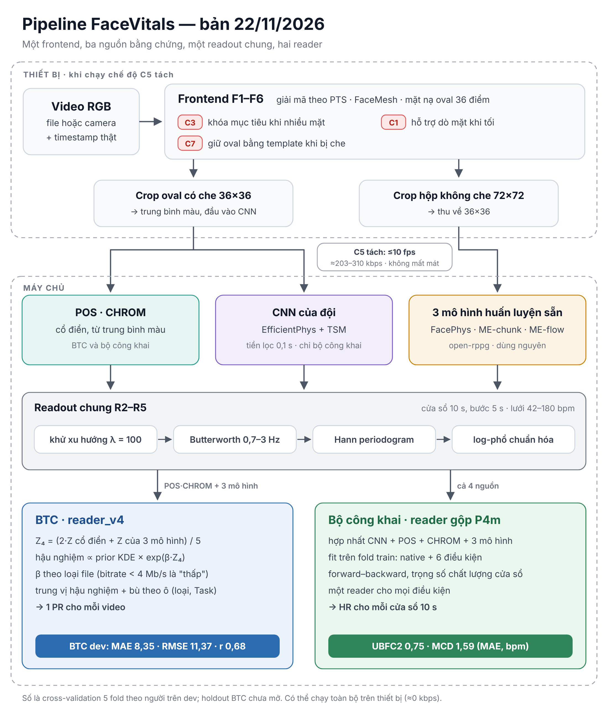

# FaceVitals — SP Cup 2027, Round 1

Ước lượng **nhịp mạch (bpm) từ video RGB khuôn mặt**, không tiếp xúc. Repo chứa code nghiên cứu, định nghĩa pipeline đã chốt và bảng kết quả trên tập phát triển (dev) **đến ngày 22/11/2026**.

> **Trạng thái 22/11/2026**
> - Pipeline đã **chốt và đóng băng tham số** cho cả hai nhánh: BTC dùng **reader_v4**, bộ công khai dùng **P4m**.
> - Gói nộp bài chạy một lệnh đang được tích hợp. Trong lúc chờ, phần [Cách chạy pipeline](#cách-chạy-pipeline) mô tả các script lịch sử và tài sản cần có; chưa kiểm trọn đường raw video → reader_v4/P4m trong môi trường mới.
> - **Holdout BTC (72 video / 41 người) chưa mở.** 7 người test của UBFC2 cũng chưa được dùng. Mọi số dưới đây là kiểm chéo ngoài fold trên dev.



## Clone về chạy từ đâu?

**Bắt đầu với [hướng dẫn cài mới](docs/GETTING_STARTED.md).** Có bốn môi trường
Python 3.12 tách riêng, cấu hình đường dẫn và kiểm SHA256 tài sản đầu vào.

```bash
git clone https://github.com/Khangle-2006/SPS_Challange.git
cd SPS_Challange
python3.12 tools/setup_env.py core
.venv/core/bin/python tools/pos_trace.py --make-demo output/demo_rgb.csv
.venv/core/bin/python tools/pos_trace.py --input output/demo_rgb.csv --output output/demo_predictions.csv
```

Demo POS dùng tín hiệu tổng hợp 90 bpm, chạy được không cần dataset/checkpoint.
Nó **không phải** pipeline reader_v4/P4m. Để lặp các bảng thật: chuẩn bị
[bundle dev và checkpoint](docs/ASSETS.md), rồi chạy `tools/repro.py init`,
`doctor`, `prepare`, `plan`. Cấu hình riêng ở `configs/paths.local.json`; không
cần sửa hàng trăm file nguồn. Thiếu tài sản thì báo thiếu và dừng, không tự tải
holdout hay thay checkpoint.

[Phạm vi kiểm trong môi trường sạch](docs/CLEAN_ENV_VALIDATION.md) phân biệt
kiểm cài đặt/tensor tổng hợp với kiểm đầy đủ raw video → pipeline. Các snapshot
nghiên cứu giữ nguyên hash; relocation chỉ thực hiện trên bản làm việc riêng.

## Mục lục

1. [Pipeline trong một trang](#pipeline-trong-một-trang)
2. [Kết quả chính](#kết-quả-chính)
3. [Cách chạy pipeline](#cách-chạy-pipeline)
4. [Cấu trúc repository](#cấu-trúc-repository)
5. [Những gì đã kiểm và chưa kiểm](#những-gì-đã-kiểm-và-chưa-kiểm)
6. [Nguồn và giấy phép](#nguồn-và-giấy-phép)

Giải thích chi tiết từng khối, kèm hình trên dữ liệu thật: **[docs/PIPELINE.md](docs/PIPELINE.md)**.

---

## Pipeline trong một trang

```text
video ──► (1) Frontend ──► (2) Nguồn tín hiệu ──► (3) Readout ──► (4) Reader ──► nhịp tim
          FaceMesh 36 điểm   mỗi nguồn ra 1 sóng   mỗi sóng ra 1     gộp bằng chứng
          oval có che 36×36   mạch (1 số/khung)     đường "bằng       + suy luận
          hộp không che 72×72                        chứng" Z(f)       theo thời gian
```

| Khối | Nội dung |
|---|---|
| **1. Frontend** | Giải mã theo timestamp thật của khung (PTS). MediaPipe FaceMesh tìm mặt; lấy 36 điểm viền mặt làm oval. Hai loại crop: **oval có che 36×36** (INTER_AREA, bỏ tóc và nền) cho POS/CHROM và CNN; **hộp chặt không che 72×72** cho ba mô hình huấn luyện sẵn. Ba trợ giúp cho constraint: khóa mục tiêu khi nhiều mặt (C3), giữ oval theo template khi mất mặt (C7), dò mặt trên bản sao tăng sáng khi tối (C1). |
| **2. Nguồn tín hiệu** | Mỗi nguồn biến chuỗi crop thành **một sóng mạch**, mỗi khung một số. **POS** (Wang 2017) và **CHROM** (de Haan 2013): công thức vật lý màu da. **CNN của đội**: EfficientPhys + TSM đã sửa padding, checkpoint ngoài fold, chỉ dùng cho bộ công khai, đầu vào lọc trung bình trượt 0,1 s. **Ba mô hình huấn luyện sẵn** của open-rppg 0.1.1: FacePhys.rlap, ME-chunk.pure, ME-flow.pure, dùng nguyên, không huấn luyện lại. |
| **3. Readout** | Áp cho mọi sóng như nhau: cửa sổ 10 s, bước 5 s → nội suy về 30 Hz theo timestamp → khử xu hướng (smoothness priors, λ = 100) → lọc Butterworth 0,7–3 Hz → periodogram Hann, nfft 4096 → log + chuẩn hóa z trên 42–180 bpm. Kết quả là đường **bằng chứng Z(f)**: mức nguồn đó ủng hộ mỗi giá trị nhịp tim. |
| **4a. Reader công khai: P4m** | E = 1·Z_CNN + 0·Z_POS + 0,25·Z_CHROM + 1·mean(Z của 3 mô hình). Forward–backward trên HMM có trọng số chất lượng cửa sổ, lấy trung vị hậu nghiệm. Một nhịp cho mỗi cửa sổ 10 s. Fit gộp trên native + 6 điều kiện mô phỏng, áp nguyên cho mọi điều kiện. |
| **4b. Reader BTC: reader_v4** | Z4 = (2·Z_cổ điển + Z_FacePhys + Z_ME-chunk + Z_ME-flow) / 5, trung bình qua cửa sổ. Bayes: hậu nghiệm ∝ prior KDE × exp(β·Z4). β riêng cho file gốc và file đã nén lại (bitrate < 4 Mb/s). Trung vị hậu nghiệm + hiệu chỉnh theo (loại file, Task). Một nhịp cho mỗi video. Fit trên native, áp nguyên cho mọi điều kiện. |
| **C5 chế độ tách** | Thiết bị chạy frontend, giữ mỗi khung thứ ⌈fps/10⌉ và gửi mỗi khung: timestamp + cờ (9 B), crop hộp thu về 36×36 nén **WebP không mất mát**, cùng (BTC) trung bình 6×6 khối của oval (432 B) hoặc (công khai) crop oval 36×36 WebP không mất mát. Máy chủ nhận đúng từng bit. Đo trên dữ liệu thật: BTC trung bình 203 kbps (giây cao nhất 253); công khai 310 kbps (giây cao nhất 469). |

Định nghĩa đóng băng, đầy đủ tham số và sha256:
- [`reports/claude_research_20261119_constraints/logs/READER_V4_DEFINITION.txt`](reports/claude_research_20261119_constraints/logs/READER_V4_DEFINITION.txt)
- [`reports/claude_research_20261119_constraints/logs/P4M_DEFINITION.txt`](reports/claude_research_20261119_constraints/logs/P4M_DEFINITION.txt)
- Mọi quyết định đưa ra sau khi đã thấy số dev được ghi trong [`logs/DEVIATIONS.txt`](reports/claude_research_20261119_constraints/logs/DEVIATIONS.txt).

---

## Kết quả chính

Đơn vị bpm, thấp hơn là tốt hơn. Cách tính:
- Kiểm chéo 5 fold **chia theo người** (một người không nằm ở cả train và test).
- MAE tính trong từng người trước, rồi lấy trung bình giữa người.
- Khoảng tin cậy 95% bằng bootstrap ghép cặp theo người, 10.000 lần, seed 0.
- Mốc so sánh "hằng số" là trung vị nhịp tim của fold train.

### BTC — reader_v4 (218 video dev / 158 người, một số cho mỗi video)

| Tập con | reader_v4 | Hằng số |
|---|---:|---:|
| Toàn bộ dev | **8,35** (RMSE 11,37; r 0,68) | 12,07 |
| File gốc từ camera | 7,79 | 13,82 |
| File đã bị ứng dụng nhắn tin nén lại | 9,26 | 9,21 |

Ở các file đã nén lại, reader ngang mốc hằng số. Đội đã đo trực tiếp trong bộ giải mã H.264: biên độ mạch (khoảng 0,3 mức xám) nằm dưới ngưỡng mà bộ nén làm tròn về 0, nên tín hiệu không còn trong file. Kể cả một bộ đọc hoàn hảo cũng chỉ xuống được khoảng 6 bpm.

**Dưới các constraint** (bảng đầy đủ: [`out/y11_v4_conditions.csv`](reports/claude_research_20261119_constraints/out/y11_v4_conditions.csv)). Cổng: a = còn ≥ 90% đầu ra; b = không kém hằng số; c = tốt hơn hằng số.

| Điều kiện | Video | MAE | Δ so hằng số [CI95] | Cổng |
|---|---:|---:|---|:-:|
| C5 tách, ≤ 10 fps | 218 | 9,82 | −2,26 [−3,67; −0,79] | abc |
| C1 tối (gain 0,25 + Poisson), giữ theo template | 200 | 9,74 | −2,76 [−3,98; −1,59] | abc |
| C1 tối + nhiễu Gauss mạnh | 197 | 12,27 | −0,34 [−1,64; +0,94] | ab |
| C2 bạch biến | 199 | 9,14 | −3,28 [−4,84; −1,74] | abc |
| C4 VGA / QVGA | 200 | 9,29 / 9,24 | −3,21 / −3,26 | abc |
| C6 da lão hóa | 197 | 8,46 | −4,07 [−5,72; −2,47] | abc |
| C7 che nửa dưới mặt, giữ theo template | 197 | 9,96 | −2,73 [−4,01; −1,48] | abc |

### Bộ công khai — P4m (một số cho mỗi cửa sổ 10 s)

UBFC2 dev: 35 người. MCD: 60 người khi chạy native và C5, 34 người cho các constraint mô phỏng. Bảng đầy đủ, gồm cả P4 và hai reader fit trên native: [`out/z13_public_p4_prefilter.csv`](reports/claude_research_20261119_constraints/out/z13_public_p4_prefilter.csv).

| Điều kiện | UBFC2 | MCD | Hằng số (UBFC2 / MCD) | Có trong fit gộp? |
|---|---:|---:|---|:-:|
| **Native** | **0,75** | **1,59** (RMSE 3,79; r 0,96) | 14,59 / 11,68 | có |
| C5 tách, ≤ 10 fps | 0,65 | 1,77 | 14,66 / 11,69 | không |
| C4 QVGA | 0,74 | 1,54 | | có |
| C6 da lão hóa | 0,76 | 1,60 | | có |
| C2 bạch biến | 0,75 | 1,74 | | có |
| C1 gain 0,5 | 1,00 | 1,89 | | không |
| C1 gain 0,25, giữ theo template | 1,62 | 2,53 | | có |
| C1 gain 0,125 | 3,00 | 2,95 | | không |
| C1 tối + nhiễu Gauss mạnh | 14,05 | 10,31 | 14,61 / 10,98 | có (cổng ab) |
| C7 che xanh, giữ theo template | 1,71 | 3,22 | | có |
| C7 che trắng | 1,21 | 3,71 | | không |

Tất cả các dòng qua đủ cổng abc, trừ C1 tối + nhiễu Gauss mạnh (chỉ qua ab, ở cả hai nhánh). Ở điều kiện đó, tín hiệu mạch thấp hơn nhiễu ngay tại cảm biến.

**Lệch quy tắc đã ghi lại.** Trước khi chạy z13, đội đặt quy tắc: P4m chỉ thay P4 nếu không có dòng nào kém đi. Kết quả: P4m kém P4 ở UBFC2 native +0,043 [+0,006; +0,080] bpm, nhưng tốt hơn ở MCD native −0,25 [−0,51; −0,08] và ở các điều kiện C1/C7. Đội chọn P4m ngày 22/11 và ghi đây là một lệch quy tắc. Số của P4 vẫn được báo cáo đầy đủ.

Kết quả lịch sử đến 15/11 (BTC 11,37; padding-fixed; V5…) vẫn giữ ở [docs/RESULTS.md](docs/RESULTS.md). Pipeline trên **thay thế** các ứng viên đó.

---

## Cách chạy pipeline

Các lệnh bên dưới mô tả quy trình nghiên cứu lịch sử và cần đủ artifact riêng.
Cài mới bắt đầu ở [GETTING_STARTED.md](docs/GETTING_STARTED.md); chưa có phép
kiểm đầy đủ mọi bảng trên môi trường mới chỉ từ nội dung Git. Một số script
fit reader trong train-fold khi chấm dev, không phải lệnh inference một video.

Đây là các bước đã dùng để tạo các bảng ở trên; muốn tái lập cần đúng bundle đầu vào và kiểm lại số. Mỗi bước là một script trong [`reports/claude_research_20261119_constraints/code/`](reports/claude_research_20261119_constraints/code/). Dòng đầu mỗi script có docstring mô tả đầu vào, đầu ra và tham số.

### 0. Điều kiện trước

**Dữ liệu và tài sản.** Không có trong Git, xin maintainer theo đúng quyền sử dụng:
- video UBFC2, MCD, BTC dev và nhãn;
- `MANIFEST.json` (cửa sổ, fold theo người, nhãn từng cửa sổ) của `round1_execution_20261110/inference_repair_20261113`;
- cache crop native của đội (`t8_oval_20261031/<dataset>/<rec>/native/crop/{rgb.npy, meta.npz}`). Tạo bằng [`ops/t8_oval_20261031/prepare_t8_cache.py`](ops/t8_oval_20261031/);
- 5 checkpoint CNN padding-fixed theo fold (`FROZEN.json` → `padding_checkpoints`);
- bảng nhân khẩu học BTC dev (chỉ cho phân tích nhóm).

**Đường dẫn.** Các script dùng đường dẫn tuyệt đối của máy chủ đội:

```text
W   = /mnt/samsung_t5/khangle/facevitals/reports/claude_research_20261119_constraints   # code/, out/, logs/
OLD = W/../claude_research_20261118/code                                                 # lib_btc.py, reader_v3
R   = W/../round1_execution_20261110/inference_repair_20261113                           # MANIFEST, FROZEN, hàm của đội
T8  = /data_pool/khangle/facevitals/code/t8_oval_20261031                                # oval_crop.py của đội
```

Trên máy khác, dùng `tools/repro.py prepare` để ánh xạ các prefix này sang workspace riêng theo `configs/paths.local.json`. Bản nguồn trong Git giữ nguyên byte; receipt relocation ghi hash của bản làm việc. Không đặt dữ liệu của bạn vào root sản xuất của đội và không sửa hash frozen để vượt assertion.

**Các môi trường lịch sử của thí nghiệm** (Python 3.12, CPU):

Để cài mới, dùng các profile có pin trong `environments/` theo
[GETTING_STARTED.md](docs/GETTING_STARTED.md), không cài gộp bảng lịch sử này.
`tools/repro.py` dùng các interpreter trong config; nếu chạy lệnh dưới đây bằng
tay, đặt `AV=/đường/dẫn/checkout/.venv/frontend/bin/python` và
`PY=/đường/dẫn/checkout/.venv/torch-cpu/bin/python`. Dùng workspace đã prepare
làm `W`, không dùng root máy chủ đội.

| Biến | Dùng cho | Gói chính (phiên bản đã chạy) |
|---|---|---|
| `$AV` | Giải mã video, FaceMesh, mô phỏng constraint, vẽ hình | numpy 1.26.4, scipy 1.17, opencv 4.11, mediapipe 0.10.21, av 14.2, matplotlib 3.11, Pillow 10.2 |
| `$PY` | CNN, POS/CHROM, readout, reader, chấm điểm | numpy 2.5, scipy 1.18, torch 2.5.1, opencv 4.10 |
| `venv_orppg` | Ba mô hình huấn luyện sẵn | open-rppg 0.1.1 (keras 3.15, backend JAX 0.12), numpy 2.5 |

```bash
python3.12 -m venv venv_orppg && venv_orppg/bin/pip install open-rppg==0.1.1
# kiểm trọng số đúng bản đã dùng (sha256 trong READER_V4_DEFINITION.txt)
sha256sum venv_orppg/lib/python3.12/site-packages/rppg/weights/{FacePhys.rlap,ME.pure}.weights.h5
```

Cần thêm `ffmpeg`/`ffprobe` (bản đã dùng: 6.1.1). Các ví dụ dưới đây chạy từ thư mục `W`. `<n>` là số tiến trình song song.

> Giới hạn tài nguyên đã dùng: `nice -n 19`, 1–2 luồng BLAS mỗi tiến trình, chừa ≥ 15 GB RAM trống. `code/x20_driver.sh` là ví dụ tạm dừng worker khi thiếu RAM.

### 1. Nhánh BTC → reader_v4

```bash
# 1.1 Frontend: crop oval có che + trung bình 6×6 khối, native và các constraint C1/C4/C6/C7
nice -n 19 $AV code/x01_extract.py <n>                          # -> out/x01/<cond>/<key>.npz
nice -n 19 $AV code/x09_followup.py <n> track:c1_g25p,aidtrack:c1_g25gv01,std:c2_vit,track:c7_blue BTC
                                                                 # trợ giúp frontend (track/aid) + C2 bạch biến

# 1.2 Crop hộp không che 72×72 cho ba mô hình
X01_SKIP_HEAVY=0 nice -n 19 $AV code/x10_boxcrop.py <n> BTC      # native, gồm cả 17 file 4K/HDR -> out/x10/<key>.npz
nice -n 19 $AV code/x15_boxcrops_conditions.py <n> track:c1_g25p,aidtrack:c1_g25gv01,std:c2_vit,std:c4_vga,std:c4_qvga,std:c6_us1,track:c7_blue

# 1.3 Bằng chứng cổ điển (POS, CHROM), mỗi video một phổ
$PY code/x03_btc_spectra.py <n> x01
$PY code/x03_btc_spectra.py <n> x09

# 1.4 Ba mô hình huấn luyện sẵn, zero-shot
for m in FacePhys.rlap ME-chunk.pure ME-flow.pure; do
  venv_orppg/bin/python code/y05_openrppg.py run $m              # native -> out/y05/<model>.npz
  for c in heavy split10 track_c1_g25p aidtrack_c1_g25gv01 c2_vit c4_vga c4_qvga c6_us1 track_c7_blue; do
    venv_orppg/bin/python code/y11_openrppg_conditions.py run $m $c
  done
done

# 1.5 reader_v4: fit trên native, áp nguyên cho mọi điều kiện, chấm với cổng
$PY code/y11_openrppg_conditions.py eval FacePhys.rlap,ME-chunk.pure,ME-flow.pure   # -> out/y11_v4_conditions.csv
$PY code/z01_btc_reader_ext.py <n>                                                  # dự đoán native từng video -> out/z01_pred.npz (khóa "v4")

# 1.6 Phân tích nhóm (da, tuổi, Patient/Normal)
$PY code/x08_strata.py score out/<pred>.npz
```

Lựa chọn ba mô hình: `venv_orppg/bin/python code/y05_openrppg.py eval` chạy chọn tiến lồng trong fold train trên các mô hình open-rppg. Mô hình nào được chọn ở ≥ 4/5 fold thì giữ.

### 2. Nhánh công khai → P4m

```bash
# 2.1 Native: tiền lọc 0,1 s trên crop oval, rồi CNN + POS + CHROM theo cửa sổ
$PY code/x13_prefilter.py <n>                                    # -> out/x13/nat_ma3, out/x13c/nat_ma3
for s in 0 1 2; do $PY code/x02_infer.py $s 3 x13 & done; wait  # -> out/x13_spec/...

# 2.2 Constraint: crop có tiền lọc + CNN + chấm z13 (một lệnh, có bảo vệ RAM)
bash code/x20_driver.sh <n>

# 2.3 Crop hộp và ba mô hình trên bộ công khai
nice -n 19 $AV code/x10_boxcrop.py <n> UBFC2,MCD
nice -n 19 $AV code/x16_boxcrops_public.py <n> std:c4_qvga,std:c6_us1,aidtrack:c1_g25gv01,std:c2_vit,track:c1_g25p,track:c7_blue,std:c1_g50p,std:c1_g12p,std:c1_g25gv001,std:c7_white
for m in FacePhys.rlap ME-chunk.pure ME-flow.pure; do
  venv_orppg/bin/python code/y12_openrppg_public.py run $m                       # native
  for c in c4_qvga c6_us1 aidtrack_c1_g25gv01 c2_vit track_c1_g25p track_c7_blue c1_g50p c1_g12p c1_g25gv001 c7_white c5_split10; do
    venv_orppg/bin/python code/y13_openrppg_public_conditions.py run $m $c
  done
done

# 2.4 C5 chế độ tách cho CNN
$PY code/x11_split10.py <n>
for s in 0 1 2; do $PY code/x02_infer.py $s 3 x11 & done; wait

# 2.5 Chấm P4 / P4m / N4 / N4m và đóng băng P4m
$PY code/z13_public_p4_prefilter.py                              # -> out/z13_public_p4_prefilter.csv
$PY code/z14_p4m_freeze.py                                       # -> out/z14_p4m_frozen.npz, logs/P4M_DEFINITION.txt
```

`z14` in ra độ lệch giữa MAE tái tạo và cột P4m của z13. Bản đã đóng băng lệch 0,00 trên cả 24 dòng.

### 3. C5 chế độ tách: băng thông và kiểm không mất mát

```bash
nice -n 19 $AV code/z08_split_lossless.py <n>                    # -> logs/z08_split_lossless.json
```

Script mã hóa crop bằng `cv2.imencode('.webp', img, [cv2.IMWRITE_WEBP_QUALITY, 101])`, giải mã lại và kiểm khớp từng bit. Nó cũng đo kbps theo **từng giây** của luồng.

### 4. C3 nhiều người

```bash
nice -n 19 $AV code/x07_c3.py <n>                                # ghép người thứ hai vào khung; so first / largest / lock
for s in 0 1 2; do $PY code/x02_infer.py $s 3 x07 & done; wait
$PY code/x05_public_score.py <n> x07
```

Cấu hình được chọn là `lock0`: `target_lock.TargetLock`, gồm Kalman, gán Hungarian và chữ ký ngoại hình, hạt giống là hộp mặt hợp lệ đầu tiên.

### 5. Hình minh họa

Các script này chỉ vẽ, không tính lại kết quả.

```bash
$AV code/f01_illustrations.py [key]     # frontend, constraint, readout, C5
$AV code/f02_evidence.py [key]          # bằng chứng từng kênh và bản gộp
$PY code/f03a_waves.py [key]            # sóng của CNN, POS, CHROM, PPG
venv_orppg/bin/python code/f03b_experts.py <key> <start_s>
$AV code/f03c_plot.py                   # hình sóng của 6 nguồn
```

Hình có mặt người từ dataset chỉ dùng nội bộ, **không đưa vào repo**. Trong [`docs/figures/`](docs/figures/) chỉ có hình tín hiệu và phổ.

### 6. Holdout

**Chưa chạy. Chỉ mở sau xác nhận riêng của người dùng/maintainer.** Bootstrap và
launcher dev-only mới không thực hiện bước holdout. Thứ tự đã định:
1. Tích hợp thành một gói.
2. Kiểm tái lập mọi số ở trên.
3. Fit reader_v4 một lần trên toàn bộ dev; P4m dùng bộ tham số `deploy`.
4. Ghi sha256 của code, trọng số và tham số vào `FROZEN_PIPELINE.json`.
5. Chạy holdout **đúng một lần**, chỉ đọc video, không đọc nhãn.

---

## Cấu trúc repository

```text
reports/claude_research_20261119_constraints/   PIPELINE ĐÃ CHỐT (19–22/11)
  code/x01..x20      frontend, constraint (C1–C7), crop, CNN/POS/CHROM, C5 tách, chấm theo cổng
  code/y01..y14      ba mô hình open-rppg (y05, y11–y13), reader công khai (y02, y07)
  code/z01..z14      mở rộng reader BTC, tiền lọc, C5 không mất mát (z08), P4m (z13, z14)
  code/u01..u34      nghiên cứu thêm 22/11 về giới hạn của BTC (không thuộc pipeline nộp)
  code/f01..f03      hình minh họa
  code/constraint_ops.py, target_lock.py, xcommon.py
  PREREG.md          cổng và quy tắc viết trước khi chạy
  logs/              READER_V4_DEFINITION, P4M_DEFINITION, DEVIATIONS, z08_split_lossless.json
  out/*.csv          bảng kết quả tổng hợp (không có dữ liệu cá nhân)
reports/claude_research_20261118/code/         reader_v3 (a11), lib_btc.py dùng chung, reader công khai 18/11
reports/round1_*/                               thí nghiệm trước 15/11 (V4, Bayes, padding-fixed, V5, …)
ops/                                            frontend T8 oval, huấn luyện CNN, adapter dữ liệu, kiểm thử
docs/PIPELINE.md                                giải thích pipeline chi tiết, kèm hình
docs/RESULTS.md, docs/*                         kết quả và giao thức đến 15/11 (lịch sử)
environments/                                  profile cài đặt core, frontend, torch-cpu, experts
configs/                                       mẫu path config và manifest tài sản riêng
tools/                                          bootstrap, doctor/prepare/plan/run, demo POS và kiểm bản phát hành
```

Các thư mục giữ tên ngày tháng vì code import theo đường dẫn tương đối và kiểm hash.

### Chạy thử không cần dữ liệu

```bash
python -m venv .venv && source .venv/bin/activate      # Windows: .venv\Scripts\Activate.ps1
python -m pip install -r requirements.txt
python tools/pos_trace.py --make-demo output/demo_rgb.csv
python tools/pos_trace.py --input output/demo_rgb.csv --output output/demo_predictions.csv
python -m unittest test_score_round1
```

Demo dùng tín hiệu **tổng hợp 90 bpm** và chỉ chạy POS cơ bản, không phải pipeline ở trên.

---

## Những gì đã kiểm và chưa kiểm

**Đã kiểm**
- **Cổng viết trước.** Cổng và quy tắc được ghi trong [`PREREG.md`](reports/claude_research_20261119_constraints/PREREG.md) trước khi chạy. Mọi quyết định đưa ra sau khi xem số dev được ghi trong `DEVIATIONS.txt`.
- **Chọn mô hình không do may.** Ba mô hình được chọn bằng chọn tiến lồng trong fold train. Đối chứng xáo nhãn không tạo ra cải thiện.
- **C5 không mất mát.** Luồng giải mã ra khớp từng bit với crop gốc. Băng thông ≤ 500 kbps được đo ở **mọi giây**, không chỉ trung bình.
- **Crop điều kiện tái tạo đúng.** Crop hộp dưới mọi điều kiện tái tạo đúng các khối đã chấm điểm: 1.407/1.407 file, lệch 0,0.
- **P4m đóng băng khớp.** Bản đóng băng tái tạo bảng z13 với lệch 0,00.

**Chưa kiểm**
- Holdout BTC chưa mở.
- Gói nộp một lệnh đang tích hợp, chưa kiểm tái lập độc lập.
- C1 tối + nhiễu Gauss mạnh chỉ qua cổng ab: ở mức đó tín hiệu mạch thấp hơn nhiễu ngay tại cảm biến.
- Các constraint C1, C2, C4, C6, C7 là mô phỏng theo mô tả hàm MATLAB của đề bài, chưa đối chiếu với video ban tổ chức tạo bằng MATLAB.
- MCD chỉ có 34 người được chạy dưới các constraint mô phỏng, vì giới hạn tính toán.

---

## Nguồn và giấy phép

- POS: Wang et al., *Algorithmic principles of remote PPG*, IEEE TBME 2017. CHROM: de Haan & Jeanne, IEEE TBME 2013.
- EfficientPhys / rPPG-Toolbox: giữ [giấy phép upstream](ops/deep_hr/TOOLBOX_LICENSE.txt) và [thông tin nguồn](THIRD_PARTY_NOTICES.md).
- Mô hình huấn luyện sẵn qua gói **open-rppg 0.1.1** (mã MIT):
  - FacePhys (arXiv 2512.06275), trọng số học trên RLAP;
  - ME-rPPG (arXiv 2504.01774), trọng số học trên PURE.

  Dùng nguyên, không huấn luyện thêm, không dùng dữ liệu BTC để huấn luyện.
- MediaPipe FaceMesh: Apache 2.0 ([giấy phép](ops/deep_hr/assets/MEDIAPIPE_LICENSE)).

Dữ liệu thuộc điều kiện sử dụng riêng của từng bộ. Repo **không** chứa video, nhãn, ảnh mặt người hay dữ liệu cá nhân, và không cấp quyền phân phối lại chúng.
