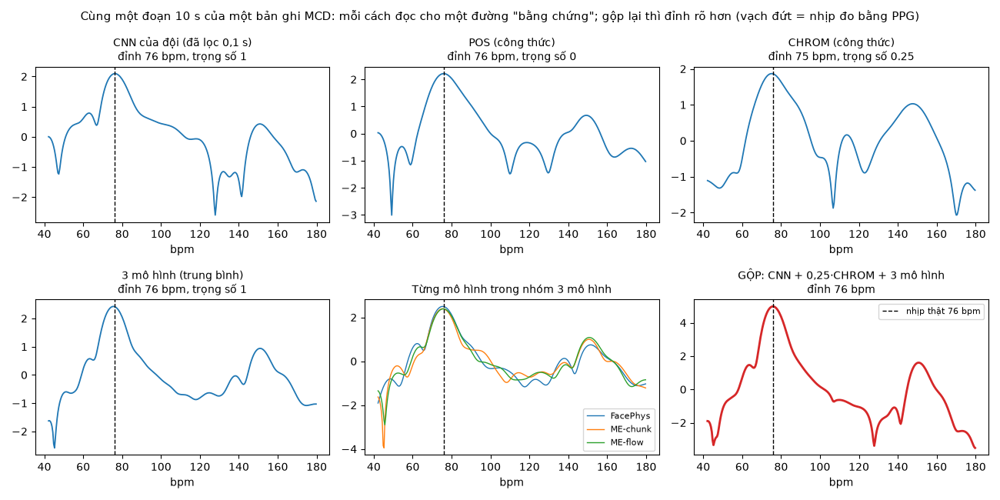

# Pipeline hiện hành — R1 ngày 23/11/2026

Hai nhánh dùng cùng nguyên tắc tách trạng thái, nhưng đầu ra và bộ đọc khác nhau. `predict.py` hiện triển khai nhánh BTC. Nhánh P4m/public chạy bằng `predict_public.py` và checkpoint ngoài fold khi chấm dev; 3 bản ghi/26 cửa sổ A1 đã khớp R1. Xem [gói nộp](SUBMISSION_ROUND1.md).

**Cập nhật 25/11.** BTC mặc định dùng bộ chọn nguồn và bộ bù bitrate thấp. Xem [README](../README.md) cho lệnh tái lập 8,020 bpm. Phần mô tả reader_v4 bên dưới áp dụng cho `--reader r1`.

## 1. Video và frontend

Giải mã bằng timestamp thật; xử lý xoay metadata một lần, dùng chuỗi HDR→SDR đã khóa. FaceMesh một mặt + template fallback tạo oval 36×36 và crop hộp không che 72×72. Không đổi detector, template hay cách resize trong R1. Bộ gác `guarded` qua cổng C3 và native reader_v3 ngày 22/11, nhưng chưa qua tái lập từng dự đoán reader_v4/P4m; không thay frontend R1. Xem [các cổng riêng](RESULTS.md#c3--phân-biệt-cổng-danh-tính-và-cổng-tái-lập).

*Sơ đồ kiến trúc 22/11 được giữ nguyên theo yêu cầu. Các số 8,35 / 0,75 / 1,59 in trong hình đã bị loại; dùng bảng R1 trong RESULTS. Nhãn bước 5 s chỉ áp BTC, public đã khóa bước 10 s; giới hạn C5 được kiểm riêng bên dưới.*

## 2. Ba expert độc lập giữa video

FacePhys.rlap, ME-chunk.pure, ME-flow.pure giữ nguyên trọng số. Ngay sau `rppg.Model(name)`, lấy `deepcopy(model.state)`. Trước **mỗi video/bản ghi/điều kiện**, khôi phục bản khởi tạo, xử lý cùng crop hai lần rồi lấy `bvp(raw=True)` của lần hai. Không dùng trạng thái của video khác để làm nóng.

MODE `selfwarm` lấy từ quyết định z18 đã ghi trước: chỉ chọn khi CI95 ghép cặp self-warm − reset có cận trên <0. BTC: 8,333 so với 9,130, delta −0,797 [−1,632; −0,076]. Kiểm phổ reset và self-warm với hai video tham chiếu, cùng kiểm A→B→A, đều có sai khác tối đa **0,0** trên cả ba model.

## 3. Tín hiệu và phổ

POS/CHROM lấy thống kê RGB của oval. CNN public là padding-fixed, đầu vào được trung bình trượt 0,1 s theo cờ valid. CNN không nằm trong reader_v4 BTC.

BTC dùng cửa sổ 10 s, bước 5 s; public R1 dùng cửa sổ 10 s, bước 10 s và đồng hồ thu đã khóa (không thay bằng PTS container). Giữ luật support; nội suy lên 30 Hz. Detrend smoothness-prior λ=100, Butterworth 0,7–3 Hz, periodogram Hann nfft=4096. Không đổi toán tử riêng của script BTC/public: lưới và cách chuẩn hóa phổ phải theo đúng nhánh, không thay lẫn nhau.

*Minh họa các tín hiệu mạch; không dùng một ví dụ để suy rộng sai số toàn bộ.*

## 4. Reader BTC

Bằng chứng `Z4 = (2·Z_classical + Z_FacePhys + Z_ME_chunk + Z_ME_flow)/5`, trong đó classical gộp CHROM/POS. Hậu nghiệm tỷ lệ với `prior_train(h) × exp(beta·Z4(h))`; lấy trung vị rồi cộng offset đã fit theo lớp nguồn và Task.

Lớp nguồn dùng bitrate **stream của video nguồn**, ngưỡng 4 Mb/s theo code đã khóa, không lấy bitrate/độ phân giải của bản giảm chất lượng để đổi lớp. Beta, prior, offset fit trong fold train. Bảng điều kiện giữ logic y11: fit native trên tập so ghép cặp của điều kiện đó, áp nguyên cho phổ điều kiện. Fit toàn dev dùng triển khai, không dùng để báo OOF.

Native: **8,333 bpm**, CI95 [7,090; 9,659], 218 video/158 người. Reader_v3 cùng tập 9,587; hằng số 12,071. Bảng tất cả điều kiện và CI ghép cặp ở [RESULTS](RESULTS.md).

## 5. Reader công khai P4m/P4

Bốn kênh theo thứ tự `(CNN, POS, CHROM, mean expert zlog)`. P4m dùng CNN đã lọc đầu vào; P4 dùng CNN không lọc. Lưới trọng số `{0; 0,5; 1; 2}^4` sau chuẩn hóa được giữ nguyên, cùng lưới gamma/sigma/tau/estimator. Fit gộp native + sáu điều kiện trong từng fold train.

| Fit P4m | Trọng số mới |
|---|---|
| Fold 0, 1, 3, 4 | (1; 0,5; 0; 1) |
| Fold 2 | (1; 0; 0,25; 1) |
| Deploy toàn dev | (1; 0,5; 0; 1) |

Readout forward–backward dùng trọng số chất lượng cửa sổ; thông số riêng từng bộ/fold được xuất nguyên trong [RESULTS](RESULTS.md) và model public. Không áp weights deploy để thay dự đoán OOF. Bản đóng băng P4m khớp bảng chấm mới **0,0** về MAE ở tất cả điều kiện × bộ.

Native P4m: **UBFC2 0,746 bpm** (193 cửa sổ/35 người), **MCD 1,511 bpm** (1.959 cửa sổ/60 người). Nhóm mô phỏng MCD dùng 34 người; không trừ trực tiếp trung bình trên hai cohort khác nhau.

*POS và readout P4m theo cửa sổ 10 giây, hình R1 đã sửa trạng thái.*

*Ví dụ R1: CNN + 0,5·POS + trung bình ba expert; trọng số riêng fold 2 khác như bảng trên.*

## 6. C5 tách luồng

Frontend chạy tại thiết bị, lấy mỗi khung thứ `k=ceil(fps/10−0,001)` theo mã đã khóa. Mỗi gói gồm timestamp+cờ 9 byte, crop hộp 36×36 WebP lossless; BTC thêm trung bình RGB 6×6 khối float32 (432 byte), public thêm oval 36×36 WebP lossless. Crop 72×72 của expert được INTER_AREA về 36×36 trước khi truyền, đúng kích thước đầu vào expert. Đây là **truyền ROI đã xử lý trên thiết bị**, không phải nén video toàn khung bằng H.264/VideoWriter.

Log `W/logs/z08_split_lossless.json`: BTC 218 bản ghi, trung bình **202,517 kbps**, cực đại giây được báo **252,584 kbps**; public 152 bản ghi có oval, trung bình **311,115 kbps**, cực đại **469,312 kbps**. Mọi kiểm giải mã trong log đều khớp bit. [Số tổng hợp và SHA nguồn](C5_TRANSPORT_EVIDENCE.json).

**Giới hạn bằng chứng:** mã bỏ giây cuối khi tính cực đại; `fps_sent` là trung bình bản ghi làm tròn, BTC cao nhất **10,002 fps**. Vì vậy log hiện có chưa chứng minh yêu cầu “≤10 fps và ≤500 kbps ở mọi giây”. Không đổi frame-skip hoặc tham số để sửa số. Dòng MAE tương ứng là `split10` (BTC) / `c5_split10` (public); không dùng hàng nén toàn video thay cho nó.

## 7. Giới hạn và lịch sử

Lỗi trạng thái 23/11 khiến số cũ **8,350 và 0,75/1,59 bị loại**. Các báo cáo/mã cũ được giữ tại [snapshot lịch sử](history/R1_STATE_BUG_20261123.md). Không dùng các hình/bảng cũ như số của bản R1.

63/63 lượt chạy mới có đúng số đầu ra so với cũ. Không huấn luyện thêm, không mở rộng grid. Việc chọn 3/17 expert đã dùng phổ kiểu cũ và chưa được làm lại; kết quả vẫn là dev sau nhiều lần nghiên cứu. Holdout BTC và test UBFC2 chưa mở. Điều kiện thiếu sáng+nhiễu mạnh không chứng minh tốt hơn hằng số. Các kiểm raw video/âm tính nằm trong [VIDEO_CLI_VALIDATION](VIDEO_CLI_VALIDATION.md).
