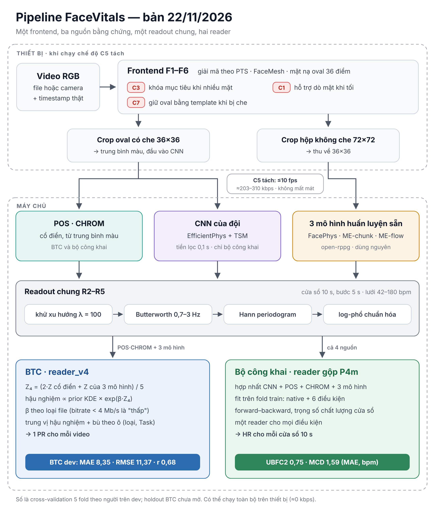
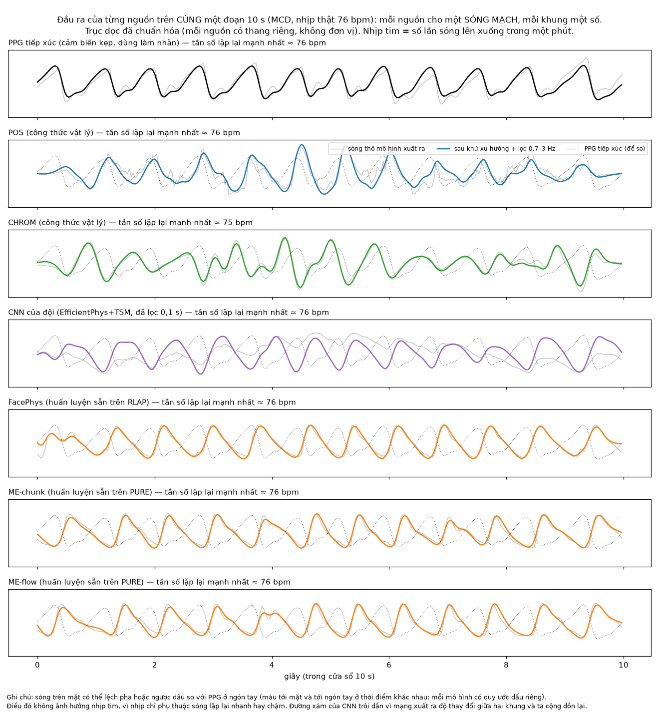
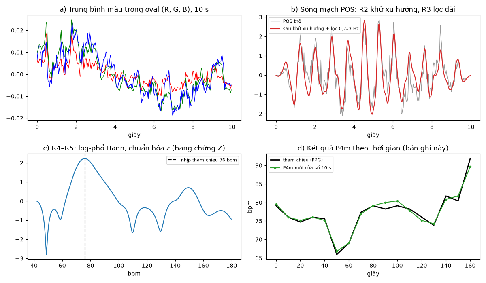

# Current pipeline — R1, 23 November 2026

Both branches isolate state, but their outputs and readers differ. `predict.py` implements BTC. Public/P4m uses `predict_public.py` and out-of-fold checkpoints for dev; A1 matched R1 on 3 recordings/26 windows. See the [submission package](SUBMISSION_ROUND1.md).

**25 November update.** BTC defaults to source selection and a low-bitrate fallback. See [README](../README.md) to reproduce 8.020 bpm. The reader_v4 description below applies to `--reader r1`.

## 1. Video and frontend

Decode with actual timestamps, rotate display metadata once, and use the frozen HDR→SDR conversion. Single-face FaceMesh plus template fallback produces 36×36 oval and unmasked 72×72 box crops. R1 changes neither detector, template, nor resizing. `guarded` passed the C3 and native reader_v3 gates on 22 November, but not per-prediction reader_v4/P4m reproduction; it does not replace the R1 frontend. See the [separate gates](RESULTS.md#c3--identity-and-reproduction-gates).

*The 22 November architecture diagram is retained as requested. Its 8.35 / 0.75 / 1.59 values were invalidated; use R1 RESULTS tables. The 5 s stride applies only to BTC; public uses the frozen 10 s stride. C5 limits are checked separately below.*

## 2. Three experts with independent per-video state

FacePhys.rlap, ME-chunk.pure, and ME-flow.pure retain their weights. Immediately after `rppg.Model(name)`, save `deepcopy(model.state)`. Before **every video/recording/condition**, restore initialization, process the same crops twice, and use `bvp(raw=True)` from pass 2. Never warm up with another video's state.

MODE `selfwarm` follows preregistered z18: select it only when the upper bound of the paired self-warm − reset CI95 is <0. BTC: 8.333 versus 9.130, delta −0.797 [−1.632; −0.076]. Reset/self-warm spectral checks on two reference videos and A→B→A checks all had maximum difference **0.0** for all three models.

## 3. Signals and spectra

POS/CHROM use oval RGB statistics. The public CNN has corrected padding and a valid-aware 0.1 s moving-average prefilter. BTC reader_v4 does not include the CNN.

BTC uses 10 s windows with 5 s stride; public R1 uses 10 s windows/stride and the frozen acquisition clock, not container PTS. Preserve support rules and interpolate to 30 Hz. Apply smoothness-prior detrending λ=100, Butterworth 0.7–3 Hz, and a Hann periodogram with nfft=4096. Preserve branch-specific BTC/public operators: grids and spectral normalization are not interchangeable.

*Illustrative pulse signals; a single example does not establish overall error.*

## 4. Reader BTC

Evidence is `Z4 = (2·Z_classical + Z_FacePhys + Z_ME_chunk + Z_ME_flow)/5`, where classical combines CHROM/POS. The posterior is proportional to `prior_train(h) × exp(beta·Z4(h))`; take its median, then add the offset fitted by source class and Task.

Source classes use the **original video-stream bitrate**, with the frozen 4 Mb/s threshold, not derivative bitrate/resolution. Beta, priors, and offsets are fitted within training folds. Condition tables retain y11 logic: fit native spectra on each condition's paired cohort and apply unchanged to condition spectra. All-dev fits are for deployment, not OOF reporting.

Native: **8.333 bpm**, CI95 [7.090; 9.659], 218 videos/158 people. Reader_v3 on the same cohort: 9.587; constant baseline: 12.071. All condition tables and paired CIs are in [RESULTS](RESULTS.md).

## 5. Public P4m/P4 reader

Four channels in order `(CNN, POS, CHROM, mean expert zlog)`. P4m uses prefiltered CNN input; P4 does not. The normalized weight grid `{0; 0.5; 1; 2}^4` and gamma/sigma/tau/estimator grids are unchanged. Fit pools native plus six conditions within each training fold.

| P4m fit | New weights |
|---|---|
| Fold 0, 1, 3, 4 | (1; 0,5; 0; 1) |
| Fold 2 | (1; 0; 0,25; 1) |
| All-dev deployment | (1; 0.5; 0; 1) |

Forward–backward readout uses window quality weights; dataset/fold-specific settings are exported unchanged in [RESULTS](RESULTS.md) and the public model. Do not replace OOF predictions with deployment weights. Frozen P4m matches the new scoring table with **0.0** MAE difference for every condition × dataset.

Native P4m: **UBFC2 0.746 bpm** (193 windows/35 people), **MCD 1.511 bpm** (1,959 windows/60 people). MCD simulated conditions use 34 people; do not directly subtract means from different cohorts.

*POS and P4m readout in 10-second windows; R1 figure with state isolation corrected.*

*R1 example: CNN + 0.5·POS + mean of three experts; fold 2 has different weights, as shown above.*

## 6. C5 split-stream transport

The frontend runs on-device and retains every `k=ceil(fps/10−0.001)`-th frame as in the frozen code. Packets include a 9-byte timestamp/flag and a 36×36 lossless WebP box crop; BTC adds 6×6 RGB block means as float32 (432 bytes), public adds a 36×36 lossless WebP oval. Expert 72×72 crops are reduced with INTER_AREA to 36×36 before transmission, matching expert inputs. This is **on-device ROI transmission**, not full-frame H.264/VideoWriter compression.

Log `W/logs/z08_split_lossless.json`: BTC 218 recordings, mean **202.517 kbps**, reported peak second **252.584 kbps**; public 152 recordings with ovals, mean **311.115 kbps**, maximum **469.312 kbps**. All logged decode checks are bit-exact. See [aggregates and source SHA](C5_TRANSPORT_EVIDENCE.json).

**Evidence limits:** the code omits the final second from peak calculations; `fps_sent` is the rounded recording average, reaching **10.002 fps** on BTC. Existing logs therefore do not establish “≤10 fps and ≤500 kbps in every second.” Frame-skip and parameters are not changed to repair results. Corresponding MAE rows are `split10` (BTC) / `c5_split10` (public), not full-video compression rows.

## 7. Limitations and history

The 23 November state bug **invalidated 8.350 and 0.75/1.59**. Older reports/code are retained as [historical snapshots](history/R1_STATE_BUG_20261123.md). Do not cite old figures/tables as R1 results.

All 63/63 new runs have the same output counts as before. No additional training or grid expansion. Selection of 3/17 experts used older spectra and has not been repeated; these remain dev results after repeated research. BTC holdout and UBFC2 test remain unopened. Severe low-light/noise conditions do not establish improvement over a constant. Raw-video/negative checks are in [VIDEO_CLI_VALIDATION](VIDEO_CLI_VALIDATION.md).
